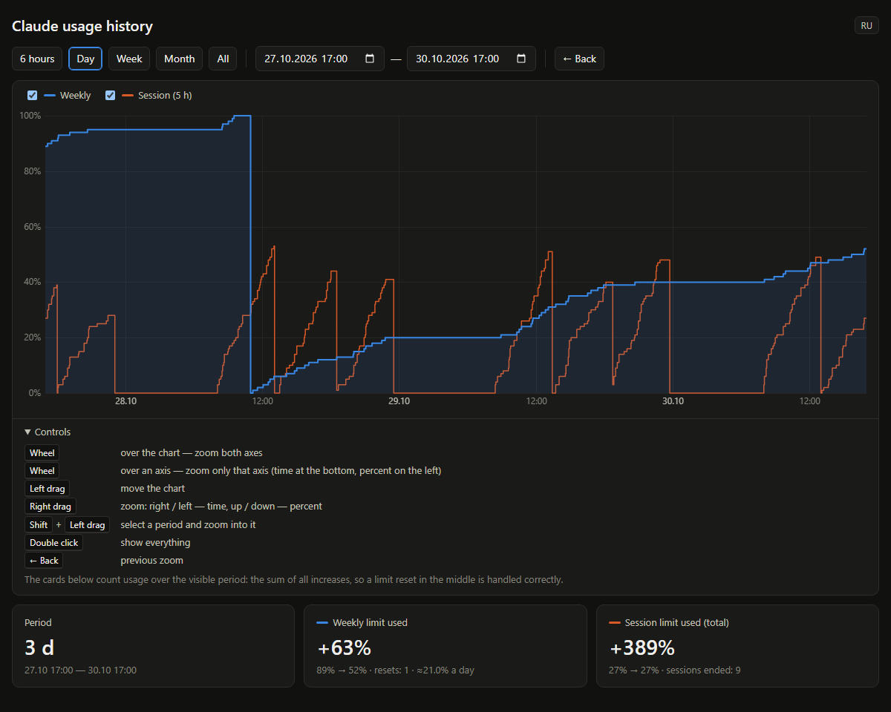

# ClaudeUsageTray

**English** · [Русский](README.ru.md)

A Windows tray icon showing your Claude subscription limits (the same numbers as `/usage` in Claude Code), plus a usage history chart.



> Unofficial tool, not affiliated with Anthropic. It relies on an undocumented endpoint that may change.

## Features
- The tray number is the 5-hour session limit in %. Green < 70, orange < 90, red >= 90.
- Right click → Style: several icon styles, drawn at the real tray size (16/20/24 px at 100/125/150%;
  display scale changes are picked up automatically):
  - Digits: session in a big font; left click shows session over weekly in a 5×7 pixel font.
  - Bar: session in a big font + a weekly bar at the bottom (grey = used, colour = left); left click swaps them.
  - Ring (thin with a bold font / thicker with a pixel font): session inside a weekly ring that turns grey
    clockwise from 12 o'clock as the limit is used. Left click swaps them.
- Left click toggles the view within a style. Style and view are saved to `mode.txt`.
- Hover: percentages and reset times.
- The top of the menu shows a limit size estimate: how much was used at API prices, the weekly and session
  limits in $, how many 5-hour sessions fit in a week and how many are left. Computed locally (`Estimate.ps1`)
  from `%USERPROFILE%\.claude\projects\**\*.jsonl`, no tokens spent. Accuracy is ±50/percent %, so rough early
  in the week. claude.ai chats are accounted for via Claude Code's share in `seven_day_breakdown`.
  Model prices live in `Get-Price`.
- **Usage history.** On every poll, if a percentage changed, a line `time,session%,weekly%` is appended to
  `history.csv` (nothing is written otherwise, ~2 MB a year). Menu → "Usage history…" opens `history.html`
  in the browser: a step chart of weekly and session usage with zoom and pan (controls are explained on the
  page). The cards below show how much was used over the visible period: the sum of all increases, so a limit
  reset in the middle is handled. The CSV is plain, so you can hand it to Claude to compute usage for any interval.

## Requirements
- Windows 10/11 with Windows PowerShell 5.1 (built in).
- Claude Code signed in with a subscription (needs `%USERPROFILE%\.claude\.credentials.json`).

## Install
1. Download the repository to any folder.
2. Double-click `start.vbs`.
3. Optional autostart — run in PowerShell from the program folder:
   ```powershell
   New-ItemProperty HKCU:\Software\Microsoft\Windows\CurrentVersion\Run -Name ClaudeUsageTray -Value "wscript.exe `"$PWD\start.vbs`"" -Force
   ```
   To remove it, delete that value or disable it in Task Manager → Startup apps.

## How it works
- Every 3 minutes it reads the OAuth token from `%USERPROFILE%\.claude\.credentials.json` and calls
  `https://api.anthropic.com/api/oauth/usage`. Nothing is sent anywhere else.
- A grey "?" means the token expired: run `claude` and it will refresh it.

## Language
Russian is used when the Windows display language or regional format is Russian, English otherwise.
To force one, create `lang.txt` containing `en` or `ru` and restart. The chart page has its own RU/EN toggle.

## Files
- `ClaudeUsageTray.ps1` — main script (PowerShell 5.1 + WinForms; keep it UTF-8 with BOM or Cyrillic breaks)
- `Icons.ps1` — icon rendering (styles, pixel font)
- `Estimate.ps1` — limit estimate from local logs
- `history.html` — the chart page
- `start.vbs` — starts the script without a console window
- Created at runtime (git-ignored): `history.csv`, `history-data.js`, `mode.txt`, `lang.txt`

## License
MIT
