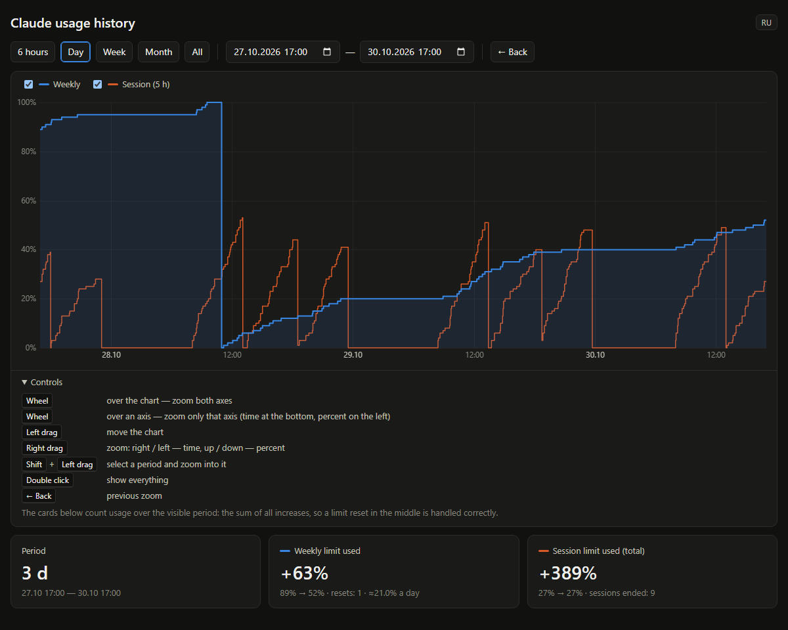

# ClaudeUsageTray

[English](README.md) · **Русский**

Иконка в трее Windows с лимитами подписки Claude (те же данные, что `/usage` в Claude Code) и история расхода с графиком.



> Неофициальный инструмент, не связан с Anthropic. Использует недокументированный endpoint, который может измениться.

## Возможности
- Цифра в трее = % 5-часового лимита сессии. Зелёный < 70, оранжевый < 90, красный >= 90.
- Правый клик → Вид: стили иконки (рисуются в реальном размере трея: 16/20/24 px при 100/125/150%,
  смена масштаба экрана подхватывается сама):
  - Цифры: сессия крупно; по левому клику сессия сверху + неделя снизу пиксельным шрифтом 5×7.
  - Полоска: сессия крупно + полоска недели снизу (серое — потрачено, цвет — осталось); по клику наоборот.
  - Рамка (тонкая с жирным шрифтом / толще с пиксельным): сессия в рамке недели; рамка сереет
    по часовой с 12 часов по мере расхода. По клику наоборот.
- Левый клик переключает вид внутри стиля. Стиль и вид запоминаются в `mode.txt`.
- Наведение: проценты и время сброса.
- Вверху меню — оценка размера лимитов: сколько потрачено в ценах API, лимит недели и сессии в $,
  сколько 5-часовых сессий влезает в неделю и сколько осталось. Считается локально (`Estimate.ps1`) по логам
  `%USERPROFILE%\.claude\projects\**\*.jsonl`, токены не тратит. Точность ±50/процент %, т.е. в начале недели грубо.
  Чаты claude.ai учитываются через долю Claude Code из `seven_day_breakdown`. Цены моделей — в `Get-Price`.
- **История расхода.** При каждом опросе, если проценты изменились, в `history.csv` дописывается строка
  `время,сессия%,неделя%` (без изменений ничего не пишется, ~2 МБ в год). Меню → «История расхода…» открывает
  `history.html` в браузере: ступенчатый график недели и сессии с масштабом и сдвигом (подсказка по управлению —
  на самой странице). Внизу — сколько потрачено за видимый период: сумма всех приростов, сброс лимита учитывается.
  CSV простой — его можно отдать Claude, чтобы посчитать расход за любой интервал.

## Требования
- Windows 10/11, Windows PowerShell 5.1 (есть в системе).
- Claude Code, в котором выполнен вход через подписку (нужен `%USERPROFILE%\.claude\.credentials.json`).

## Установка
1. Скачай репозиторий в любую папку.
2. Запусти `start.vbs` двойным кликом.
3. Автозагрузка (необязательно), в PowerShell из папки программы:
   ```powershell
   New-ItemProperty HKCU:\Software\Microsoft\Windows\CurrentVersion\Run -Name ClaudeUsageTray -Value "wscript.exe `"$PWD\start.vbs`"" -Force
   ```
   Убрать — удалить это значение или выключить в Диспетчер задач → Автозагрузка.

## Как это работает
- Раз в 3 минуты читает OAuth-токен из `%USERPROFILE%\.claude\.credentials.json` и запрашивает
  `https://api.anthropic.com/api/oauth/usage`. Больше никуда ничего не отправляется.
- Серый «?» = токен истёк: запусти `claude`, он обновит токен.

## Язык
Русский включается, если язык Windows или региональный формат — русский, иначе английский.
Принудительно: создай `lang.txt` с `en` или `ru` и перезапусти. На странице графика есть свой переключатель RU/EN.

## Файлы
- `ClaudeUsageTray.ps1` — основной скрипт (PowerShell 5.1 + WinForms, UTF-8 с BOM — без BOM поломается кириллица)
- `Icons.ps1` — рисование иконок (стили, пиксельный шрифт)
- `Estimate.ps1` — оценка лимитов по локальным логам
- `history.html` — страница с графиком
- `start.vbs` — запуск без окна консоли
- Создаются при работе (в `.gitignore`): `history.csv`, `history-data.js`, `mode.txt`, `lang.txt`

## Лицензия
MIT
